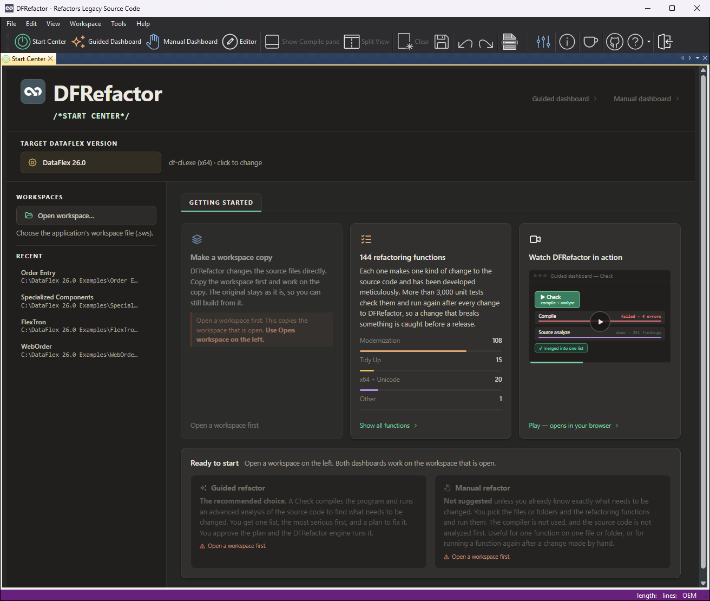
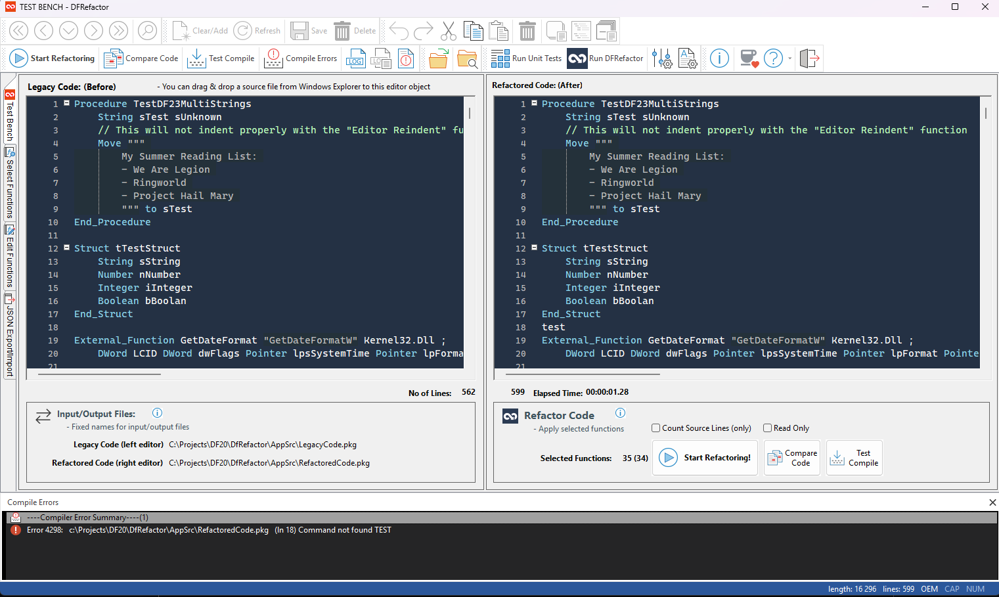

# DFRefactor - An Automated Refactoring Tool for DataFlex

**Inspired by Martin Fowler's *Refactoring: Improving the Design of Existing Code* (2019 - Second Edition).**

## What is this?

DFRefactor is a free, open-source tool that modernizes **DataFlex** source code — a business application language dating to the 1980s, still in active commercial use today. It reads your existing source code, finds code that should be written differently in a newer DataFlex version, or that the newer version no longer accepts, and rewrites it. The changes are made automatically, in many files at a time, and they can be undone.

The tool implements both **canonical refactorings from Fowler's book** (Remove Dead Code, Replace Class, the spirit of Decompose Conditional) and **DataFlex-specific transformations** for legacy syntax that no general-purpose IDE would know how to modernize — like the 1980s square-bracket `[Found]` indicators, which it rewrites into modern expressions.

DFRefactor is written entirely in DataFlex and is distributed under the MIT license.



## Online help

The complete manual is online: **https://nilssve.github.io/DfRefactor/**

It covers a full session step by step, every refactoring function with before-and-after examples, the command line, and how to add functions of your own. The same help is in `Help\DFRefactor.chm`.

---

## What it does

When you move a workspace to a newer DataFlex version, old code ends up in one of three situations:

* **It no longer compiles.** The compiler reports an error for each removed command or call. DFRefactor links each error to the function that fixes it, and shows them all in one list.
* **It compiles, but with warnings.** A warning in this release is often an error in the next one.
* **It compiles without any messages.** The code is obsolete, but the compiler never points to it. DFRefactor finds it by scanning the source code directly (**Analyze Source**).

You work in one of two ways, and can switch at any time:

* **Guided refactor** — one **Check** compiles your program with the compiler of the version you are moving to and scans the source code. It shows one list of findings, sorted by how serious they are. You approve a plan, and the plan is run. Each round is recorded, so you can see the number of findings go down.
* **Manual refactor** — you select the folders and the functions yourself, and run them.

Nothing is changed without your approval: the plan shows every file each function will change, **Read Only** reports what *would* change without changing anything, and every changed file is backed up first. **Compare Source** shows the differences, and **Revert** restores the originals.

---

## Requirements

* **DataFlex 26 (DataFlex Studio 2026)** to compile and run DFRefactor itself.
* The workspaces you refactor can be much older. DFRefactor officially supports moving code **to** the two most recent major DataFlex releases — currently DataFlex 25 and 26.

An older version of the tool, for DataFlex versions before 2023, is available in the `DFRefactor-for-DF-19-(32bit)` branch. It is no longer maintained, so use it at your own risk.

## Installation

It is recommended to use the GitHub Desktop app, which you can download from https://desktop.github.com/download/.

Click the **<> Code** button on this GitHub page and select **Open with GitHub Desktop**. Or, in GitHub Desktop, select **File > Clone a repository**, choose the **URL** tab, paste `https://github.com/NilsSve/DfRefactor`, select a local folder and click **Clone**.

Then open **`DFRefactorFlexTron.sws`** in DataFlex Studio 2026. The libraries DFRefactor uses are DataFlex 26 packages, listed in that workspace file, and the Studio installs them the first time the workspace is opened: DUF, RDCToolsLib, DFAbout, vWin32fh, RDCFlexTron and DFUnit, plus DataAccess's FlexTron Web UI. (From the command line, `df-cli config` in the repository folder does the same.)

> **Note:** "Download ZIP" also works, because the libraries come as packages. The `Libraries\` folder holds the same libraries as *git submodules*, for working on their source code; you do not need them to compile DFRefactor. To fetch them, run `git submodule update --init --recursive` once after cloning.

---

## The programs

The workspace contains these programs:

| Program | What it is |
|---|---|
| **DFRefactorFT.src** | **DFRefactor** — the application, with the FlexTron interface: the Start Center, the guided Check, the dashboard and the Modernization Analyzer. This is the program you work with. |
| **TestBench.src** | A tool for developing and testing your own refactoring functions. It runs a function on a test file (`AppSrc\LegacyCode.pkg`) and shows the code before and after the change side by side. It also contains the JSON Export/Import feature for sharing functions. |
| **UnitTests.src** | The unit tests for DFRefactor's function library — about 3,300 of them. Add tests for every new refactoring function. |
| **DFRefactor.src** | The classic interface of DFRefactor, still included. |
| **DUFUpdateProgram.src** | Updates DFRefactor's database. DFRefactor starts it automatically when its tables need to be updated. |

`MetaTagCheck.src`, `FunctionHelpGen.src` and `HarvestWin32Projection.src` are developer tools: they check the functions' meta-tags, generate the function pages of the help, and build the Win32 API catalogue.



## Adding refactoring functions

New functions go into the function library: `AppSrc\oRefactorFuncLib.pkg`, or the `AppSrc\*RefactorFunctions.inc` file of the function's family (or `AppSrc\UserDefinedRefactorFunctions.pkg` for your own). A function is registered with the `{ Published = True }` meta-tag above it, and its `{ Description }` meta-tag says what kind of function it is and how it appears in the program:

```
{ Published = True }
{ Description = """
    Human-readable description of what the function does.
    { MethodType = eStandardFunction }
    { SummaryText = Short post-run summary text }
    { FnGroup = Modernization }
    """ }
```

The `MethodType` decides what the function receives: one source line at a time (`eStandardFunction`, `eRemoveFunction`), a whole file as a string array (`eEditorFunction`, `eOtherFunction`, `eReportFunction`), or all selected files at once (`eOtherFunctionAll`, `eReportFunctionAll`). A line-by-line function has the interface `String ByRef sLine` plus an optional `String sParameter`, and returns True when it changed the line.

The help's **How It All Works** page describes all the meta-tags, and how to connect a function to the compiler message it fixes.

### Working with an AI coding assistant

[`AGENTS.md`](AGENTS.md) describes the project for AI coding assistants - and is a good read for anyone
about to change the code: how to build and test, how the function library is organised, the rules for
adding a refactoring function, and the few things that must never be done (such as writing a customer's
name into the source). Codex, Cursor, GitHub Copilot and other tools that follow the `AGENTS.md`
convention read it on their own; Claude Code reads it through [`CLAUDE.md`](CLAUDE.md). If your tool
reads a different file name, point it at `AGENTS.md`.

---

## Command line and CI

DFRefactor and its unit tests both run unattended, which makes them usable in build scripts and CI pipelines. The **Command-Line Usage** page of the help has the full details.

### DFRefactor

The usual way is to configure a workspace interactively, then select **Tools > Export to a Batch-mode INI File...**. That writes an ini-file with the workspace, folders, file filter and functions, plus a PowerShell wrapper (`<ini name>_RUN.ps1`) that runs it with a timeout and checks the result:

```
DFRefactorFT64.exe /bm "DFRefactor_Order_Entry.ini"
```

The **CI scan** runs Analyze Source without changing any files, and fails the build only when there are findings that are not in a saved baseline. The results are also written as SARIF, which GitHub shows on a pull request:

```
DFRefactorFT64.exe /scan "DFRefactor_Order_Entry.ini" /baseline    (once: save the baseline)
DFRefactorFT64.exe /scan "DFRefactor_Order_Entry.ini"
```

The export also writes `<ini name>_SCAN.ps1` and a sample GitHub Actions workflow, `<ini name>_CI-SAMPLE.yml`.

| Flag(s) | Value | Meaning |
|---|---|---|
| `/bm` `/batch_mode` | `"file.ini"` | Run the settings in an ini-file (the usual way) |
| `/scan` | `"file.ini"` | Run the CI scan; add `/baseline` to save the current findings as the baseline |
| `/sws` | `"file.sws"` | The workspace file |
| `/f` `/file` | `"file"` | A single source file |
| `/d` `/dirs` `/folders` | `A;B;C` | Folders, added to the folders saved for the workspace |
| `/b` `/batch` | — | Run the settings stored for the workspace |
| `/h` `/help` `/?` | — | Show the parameter help |

Exit code 0 means success; the result file named in the ini-file says `STATUS=SUCCESS` or `STATUS=FAILED`.

### Unit tests

```
UnitTests64.exe -c -o "results.xml"
```

`-c` (`--console`) runs all tests without a window and exits with 0 when they all pass, or -1 when any fails. `-o` also writes a JUnit-style XML report for a CI system.

> Note: `-c` means *console / CI mode* for the unit tests, but for DFRefactor it is the superseded way to pass an ini-file. They are separate programs.

---

## Feedback

* Bug reports and ideas: [Issues](https://github.com/NilsSve/DfRefactor/issues)
* Questions and suggestions: [Discussions](https://github.com/NilsSve/DfRefactor/discussions)

Need a refactoring function that isn't in the library, or help with a full legacy-code migration? RDC Tools International can design, implement and unit-test one for your code base — see the **Feedback** page of the help.
